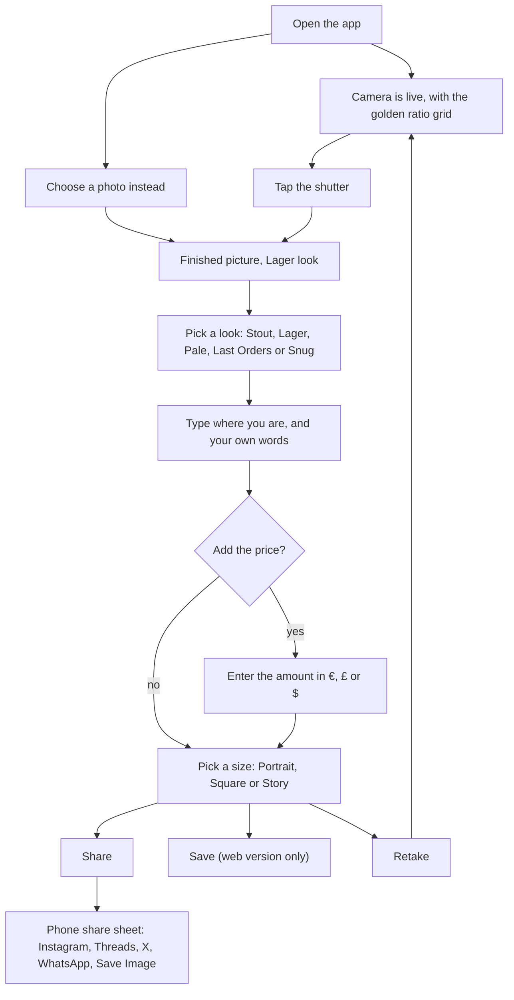

# Workflow

## In the app

The pub, your words, the currency and the look are remembered between visits. The price is not, because it changes every round.

## Screens
| Screen | What is on it |
|---|---|
| Viewfinder | Live camera cropped to the chosen size, golden ratio grid with four cyan dots, shutter, Choose photo |
| Picture | The finished image with its watermark, look chips, Retake, Save, Share |
| Details | Where, Say something, price switch, and a folded away Size and grid section |

The default size is portrait (4:5), the shape phone photos of a drink usually arrive in. Currency can be €, £ or $. Dark photos are lifted automatically before the look is applied. There are no accounts, no feed, no settings screen and no onboarding.

## Share behaviour
Share opens the phone's share sheet with the image and nothing else. There is no caption to copy or paste, because the pub, your words, the price and the time are drawn into the picture. That suits Stories. Inside the iPhone app the picture is written to the cache and shared with the native share sheet (which also offers Save Image, so Save is hidden there). In a browser that cannot share files, the image is saved instead.

## Release path
Each stage costs more and takes longer, and each tells you whether to carry on.

**Stage 0: the web version, for friends. Cost: nothing.**
Merge the website branch, copy the pages into `Website-upload`, upload to Cloudflare. The web version is then at `youknowthatsite.com/wishyouwerebeer/app/`. Open it in Safari on a phone and use Add to Home Screen. Check by page title with curl, because unknown paths show the home page.

**Stage 1: TestFlight. Cost: nothing extra (the developer programme is already paid).**
Follow `Docs/build-ios.md`. The project is generated but has never been run. Upload through Xcode Organizer, on Colm's go. Test with friends as internal testers.

**Stage 2: App Store submission.**
Follow `AppStore/submission-checklist.md`. Screenshots must come from the real app with a photo of a plain glass.

**Later options:** keep the whole photo in a Story instead of cropping the sides; a nearby places picker (Apple's place search, location permission, privacy answers change); a price map (`Docs/price-map-plan.md`); a native camera if Apple objects to the web camera inside the app.

## Website
`node scripts/build-site.js <website folder>` puts the landing, privacy and support pages, the web app, the icon and a headers file into a clone of the site. It never edits the homepage; the card is added by hand (it is already on the branch). Keep `Website` and `Website-upload` identical.
