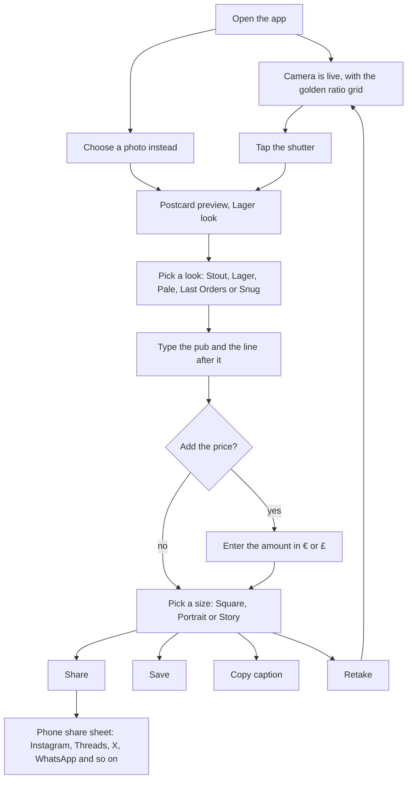

# Workflow

## In the app

The pub name, the line after it, the currency and the look are remembered between visits. The price is not, because it changes every round.

## Screens

| Screen | What is on it |
| --- | --- |
| Viewfinder | Live camera cropped to the chosen size, golden ratio grid with four amber dots, shutter, Choose photo |
| Postcard | The finished image with watermark, look chips, Retake, Copy caption, Save, Share |
| Details | Where, text after the location, price switch, grid switch, size |

The default size is portrait (4:5), because that is the shape phone photos of a drink usually arrive in, and square would crop them. Currency can be €, £ or $. Dark photos are lifted automatically before the look is applied.

There are no accounts, no feed, no settings screen and no onboarding.

## Share behaviour

The caption holds the pub, your line, the price, the hashtag and a Google Maps search link for the pub, which you can switch off. Maps links are clickable on X, Threads, WhatsApp and Facebook. Instagram captions do not turn links into clickable text, so there the link only works if someone copies it. The app cannot set an Instagram location tag for you, because Instagram does not accept one from a share sheet.

Share copies the caption first, then opens the phone's share sheet with the image. Instagram ignores any caption sent with an image, so the person pastes it in. If the browser cannot share files, the image is saved instead and the caption is still copied.

## Release path

I would not go straight to the App Store. Each stage costs more and takes longer, and each one tells you whether to carry on.

**Stage 0: share the web version with friends. Cost: nothing. Time: an afternoon.**
The app is already installable from Safari ("Add to Home Screen"), has an icon and works offline. To host it, merge this branch into `main`, then in the GitHub repository settings turn on Pages and deploy from `main`. The address should be `https://colmjackson.github.io/my-repository/wish-you-were-beer/`. VERIFY once Pages is on. Camera access needs that secure address, which Pages provides.

What to learn here: whether your friends actually post the cards, which looks they pick, and whether anyone fills in the price.

**Stage 1: TestFlight build. Cost: the developer programme fee. Time: a weekend or two.**
Wrap the page with Capacitor, which puts it inside a native iPhone app. Use the native camera and native share plugins so the app does things a website cannot. That matters for review, because a plain website in a frame risks rejection for minimum functionality. You need a Mac with Xcode, or a cloud build service. VERIFY which you have.

**Stage 2: App Store submission. Time: a few days of waiting on review.**
Checklist: icon (1024 pixel version is in `icons/icon-1024.png`), screenshots (real ones), listing text (`APP_STORE.md`), privacy policy URL (`PRIVACY.md`), age rating answers, review notes, support URL and email.

**Option for later: a native SwiftUI rewrite.**
Better camera control and a more native feel, at the cost of throwing the web code away. Only worth it if Stage 1 shows people use the app.

## Things I would not build yet

A feed, accounts, likes, or a leaderboard of any kind. They contradict the simple idea and they reward drinking more. The anonymous price log is the only server feature I would consider, and its plan is in `PRICE_LOG.md`.
